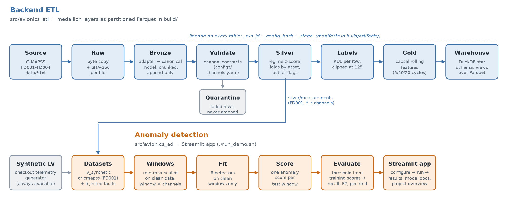

# Platform overview

What this repository is, how its two halves fit together, and what state each part is in.

## The project

| | |
|---|---|
| Problem | ISRO/VSSC: *AI-powered analytics platform for requalification of avionics from recovered vehicle stages* (`Project-Avionics.pdf`) |
| Data available | NASA C-MAPSS turbofan run-to-failure data (FD001–FD004, `data/`). There is no run-to-failure data for recovered avionics. |
| Approach | Use C-MAPSS as a **surrogate**, and design the platform so it survives the swap to real VSSC telemetry |
| Deliverable | A research proposal (`docs/00-project-plan.md`). The code here is the proof of concept that backs it, not a production platform. |

## Two halves



*Regenerate with `.venv/bin/python docs/figures/make_platform_figure.py`.*

| Half | Package | Purpose | Entry point |
|---|---|---|---|
| Backend ETL | `src/avionics_etl` | Ingest, validate, normalise and store telemetry as layered Parquet, with lineage | `make all` / `python -m avionics_etl.<stage>` |
| Anomaly detection | `src/avionics_ad` | Fit 8 detectors on clean windows, score injected faults, evaluate recall-first | `./run_demo.sh` |

## Backend ETL: the medallion layers

Each layer is written by one stage, read by the next, and can be rebuilt from the layer before it plus the config.

| Layer | Stage (module) | What it does | Output | Rows (C-MAPSS, all 4 subsets) |
|---|---|---|---|---|
| Raw | `extract.raw` | Copies source files byte-for-byte and records a SHA-256 for each. Parses nothing. | `build/raw/` | 14 files |
| Bronze | `extract.ingest` | Adapter maps the source to the canonical model, then chunked, append-only writes to partitioned Parquet | `build/bronze/{measurements,external_labels}/source_id=…` | 265,256 + 707 RUL rows |
| Validated | `transform.validate` | Checks every row against the channel contracts (`configs/channels.yaml`). Failures go to quarantine, never silently dropped. | `build/silver/validated/`, `build/quarantine/` | 265,256 kept, 0 quarantined |
| Silver | `transform.silver` | Regime per row, train/validation/holdout fold by asset, regime-wise z-score fitted on train only, outlier **flags** (rows kept) | `build/silver/measurements/` | 265,256 (14 regime groups, 68,174 rows flagged) |
| Labels | `transform.labels` | RUL labels: derived for complete runs, from `RUL_FD00x.txt` for truncated ones, clipped at 125 | `build/silver/labels/` | 265,256 |
| Gold | `transform.gold` | Causal rolling features (mean, std, min, max, slope over 5/10/20 cycles) joined to labels | `build/gold/features/` | 265,256 × 357 features |
| Warehouse | `load.warehouse` | DuckDB star schema. Views over Parquet, not copies. | `build/artifacts/warehouse.duckdb` | 4 sources, 1,416 assets, 6 regimes; facts are views over silver and gold |

## Design choices that carry to real data

| Choice | Where | Why |
|---|---|---|
| Source adapters + canonical model | `adapters/`, `canonical/model.py` | Only the adapter knows the C-MAPSS layout. A VSSC source is one new adapter plus one channel registry. |
| Contracts in config, quarantine on failure | `contracts.py`, `transform/validate.py` | Deterministic bound checks are qualification evidence. A domain expert can edit them without touching Python. |
| Lineage on every table | `lineage.py`, `build/artifacts/manifests/` | Each row carries `_run_id`, `_config_hash` and `_stage`, so a number can be traced back to its source bytes |
| Partitioned, sorted Parquet | `load/parquet_writer.py` | Hive partitions by `source_id`. Partitions are replaced atomically, so stages can be safely re-run. |
| Bounded-memory, append-only ingest | `extract/ingest.py` | Memory scales with chunk size (`ingest.chunk_rows`), not file size. Only ingest works this way so far; see *Scale* below. |
| Fit on train only, split by asset | `transform/normalize.py`, `serve/splits.py` | Prevents leakage. Rows from one engine never span folds. |
| Causal features only | `transform/causal.py` | A recovered unit's history is truncated, so features may never look ahead |
| Flag outliers, never delete | `transform/outliers.py` | In fault detection, "unusual" is what we are looking for |
| ETL→ML handoff | `serve/contract.py` | IDs, features and labels are returned separately, so identifiers cannot leak into a model |
| Images path | `extract/images.py` | A content-addressed blob store plus a Parquet manifest. Built as a path only: C-MAPSS has no images. |

## How the app uses the backend

| Dataset | Source | Notes |
|---|---|---|
| `lv_synthetic` | `avionics_etl.synthetic.lv_telemetry`, generated in memory | Always ready |
| `cmapss` | `build/silver/measurements`, FD001, regime-normalised `*_z` channels, complete trajectories | 40 train / 20 test engines. The three fault kinds are injected into the test engines. Needs `make all`. |

## Running the backend

| Command | Does | Time |
|---|---|---|
| `make all` | raw → bronze → validate → silver (all the app needs) | ~2 min |
| `make labels` | RUL labels | ~25 s |
| `make gold` | Everything up to silver, then labels, then gold | ~6 min (gold alone ~4.5 min) |
| `make warehouse` | Everything above, then the DuckDB warehouse | +1 s |
| `PYTHONPATH=src .venv/bin/python -m avionics_etl.load.warehouse --demo` | Example queries: fleet overview, degradation by regime, outliers vs. life phase, one asset's last cycles | seconds |
| `make clean-build` | Deletes `build/` | |

Query any layer directly with DuckDB:

```python
import duckdb
duckdb.sql("""
  SELECT source_id, count(*) AS rows, count(DISTINCT asset_uid) AS engines
  FROM read_parquet('build/silver/measurements/**/*.parquet', hive_partitioning=1)
  GROUP BY 1 ORDER BY 1
""").show()
```

## Status and caveats

| Item | Status |
|---|---|
| raw, bronze, validate, silver, labels | Built and verified on all 4 subsets |
| gold, warehouse | Built and verified (warehouse `--demo` queries return results). Gold is slow: ~4.5 min, mostly per-asset rolling statistics. |
| `configs/sources.yaml` | Reconstructed from `data/readme.txt` (trajectory counts, conditions, fault modes) |
| `configs/pipeline.yaml`, `configs/channels.yaml` | **Reconstructed**, because the originals were missing. Channel bounds are the observed min/max padded by 10%, so **0 quarantined rows is true by construction and is not evidence**. Replace them with engineering limits before citing validation results. |
| Scale | **Does not meet the 64 GB requirement yet.** Only ingest streams. Validate, silver, labels and gold each load their whole input into pandas: 1.0–1.1 GB peak memory for 43 MB of input, and silver alone takes 88 s. A rough projection to 64 GB is ~1.3 TB of RAM and days of single-core time. Fix without Spark: process per partition/asset, compute the global normalisation statistics with DuckDB over the Parquet files, and run partitions in parallel. |
| Images | Path only. No image data exists. |
| Docstrings citing `docs/PRIMER.md` | That file is `docs/02-domain-primer.md` |

## Other docs

| File | Content |
|---|---|
| `docs/00-project-plan.md` | Proposal plan, deliverables, schedule |
| `docs/01-pi-meeting-brief.md` | PI meeting brief |
| `docs/02-domain-primer.md` | Domain primer: requalification, PHM, C-MAPSS, data-engineering vocabulary |
| `docs/03-approach-note.md` | From telemetry to a requalification verdict |
| `src/avionics_etl/adapters/README.md` | How to add a data source |
| App → **Model docs** page | Each detector, its parameters and its score |
